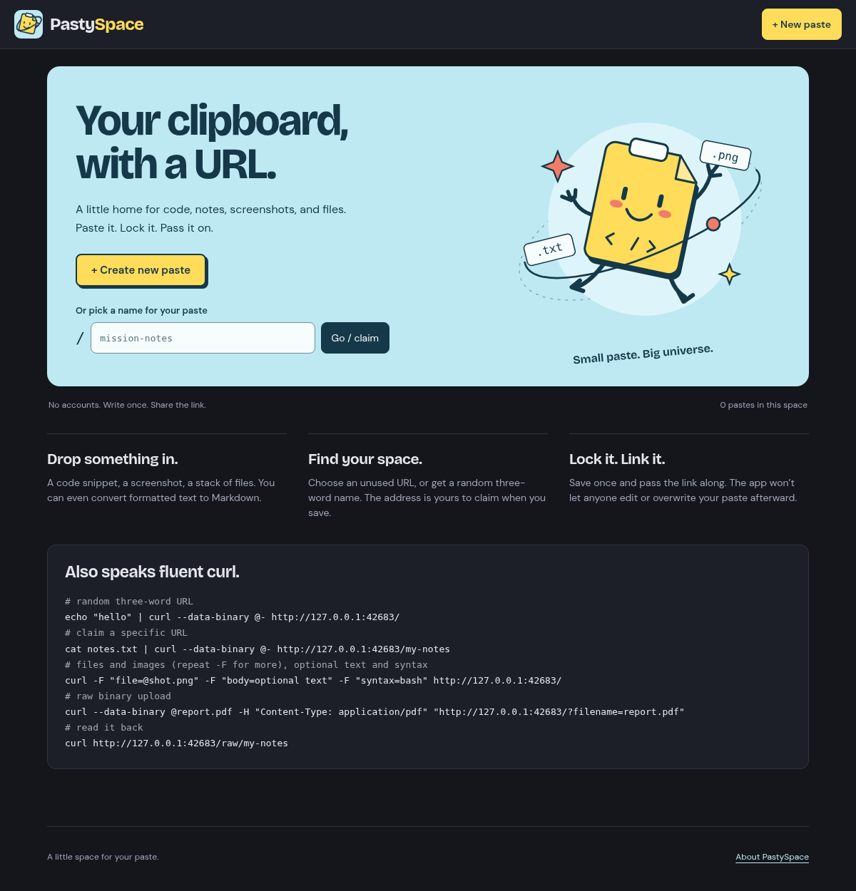
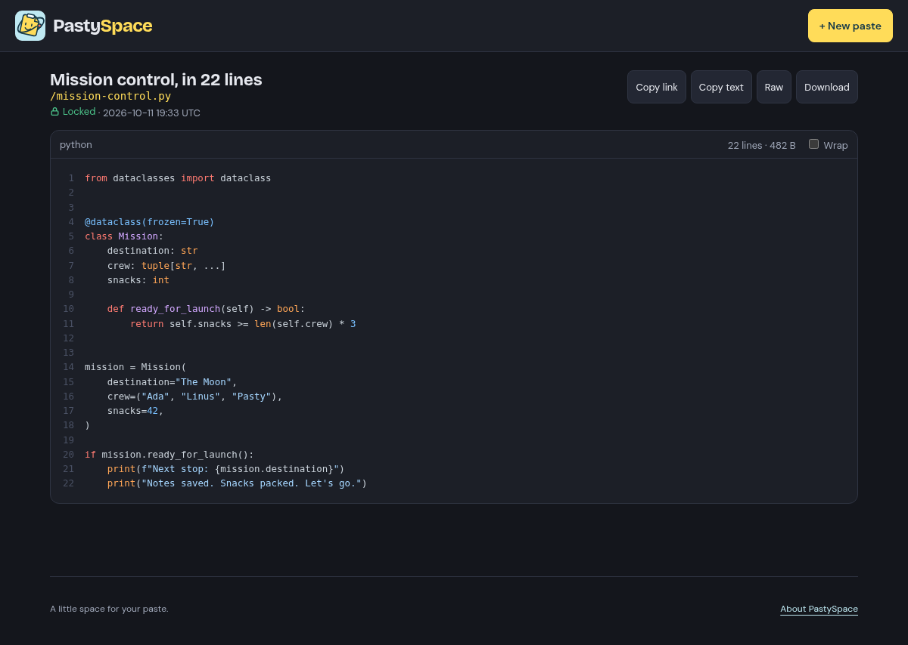

<p align="center">
  
</p>

<h1 align="center">PastySpace</h1>
<p align="center"><strong>Your clipboard, with a URL.</strong></p>
<p align="center">Paste it. Lock it. Pass it on.</p>
<p align="center">
  <a href="https://mubix.github.io/pastyspace/">Website</a> ·
  <a href="https://mubix.github.io/pastyspace/features.html">Features</a> ·
  <a href="https://mubix.github.io/pastyspace/deploy.html">Deployment guide</a>
</p>

A tiny, self-hosted, write-once pastebin for text, code, screenshots, and files. No accounts or workspaces to set up. Choose a URL, save something, and share the link.



## A little space for whatever you’re sharing

- **Code and notes:** syntax highlighting with automatic language detection or a format you choose, line numbers, wrapping, raw text, and downloads.
- **Readable formatting:** rendered Markdown, sandboxed HTML previews without scripts, and optional rich-text-to-Markdown conversion when pasting from Word or web pages.
- **Files welcome:** paste a screenshot from the clipboard, drag files onto the page, or use the file picker. Images, audio, and video preview inline when the browser supports them; other files get a download link.
- **Friendly URLs:** choose an unused name or get three random words from the 6,216-word list, giving roughly 240 billion possible combinations.
- **Write once:** saved pastes can’t be edited or overwritten through the app. Make a new paste for a revision.
- **Terminal friendly:** send text or files with `curl` and get a paste URL back.

<details>
<summary>Take a look at a saved paste</summary>



</details>

## Give your pastes a home

With Git, Docker, and Docker Compose installed:

```sh
git clone --branch main https://github.com/mubix/pastyspace.git
cd pastyspace
docker compose up -d --build
```

Open **http://localhost:8000**, or your server’s hostname/IP at port `8000`. Choose **New paste**, add your content, and click **Save & lock**. Or visit a name such as `/mission-notes` to claim it when you save. An unused URL intentionally serves the editor with a `404` status until it has a saved paste.

The app runs as one container with a SQLite database. Its fonts and browser libraries are served locally; there is no frontend build step.

### Make it yours

| Setting | Default | What it does |
| --- | --- | --- |
| `PASTY_MAX_MB` | `50` | Limits the entire request, including text, all files, and multipart overhead. |
| `PASTY_DB` | `/data/pastyspace.db` in Docker | Sets the database path. Keep it under the mounted `/data` directory in Docker. Direct Python execution defaults to `data/pastyspace.db` beneath the app directory. |
| Published port | `8000:8000` | The left-hand number is the port on your host. |

To change the upload limit, edit `PASTY_MAX_MB` in `docker-compose.yml`, then run `docker compose up -d` again. The supplied file sets this value directly, so a shell variable or `.env` file alone won’t override it.

### Storage and access

Paste bodies are stored as text in SQLite; attached files are base64-encoded. The named Docker volume `pastydata` survives ordinary stops, restarts, and rebuilds. There is **no automatic expiry**. Keep a separate copy of anything you need to preserve.

There is no built-in authentication, paste password, or rate limiting. Anyone who can reach a paste or attachment URL can read it. Use a trusted network or put access control and HTTPS at a reverse proxy. The supplied Compose file publishes port `8000` on the host’s interfaces; keep that port behind your proxy when using one. See the [deployment guide](https://mubix.github.io/pastyspace/deploy.html#access) for details.

```sh
# Follow the app logs
docker compose logs -f pastyspace

# Stop the app while keeping its data
docker compose down

# Start it again
docker compose up -d
```

**A fresh start deletes everything:** `docker compose down -v` removes the named volume and all pastes and attachments inside it. Use it only when you intend to wipe the instance.

## Also speaks fluent curl

Replace `http://localhost:8000` with your instance’s address.

```sh
# Get a random three-word URL
echo "hello, space" | curl --data-binary @- http://localhost:8000/

# Claim a name; an existing paste returns 409 Conflict
cat notes.txt | curl --data-binary @- http://localhost:8000/mission-notes

# Attach a file and optional text; repeat -F file=... for more files
curl -F "file=@screenshot.png" -F "body=Here is the screenshot" \
  http://localhost:8000/

# Choose how text should render
curl -F "body=# Mission notes" -F "syntax=markdown" http://localhost:8000/

# Read a paste back as plain text
curl http://localhost:8000/raw/mission-notes
```

## Brand and website

The orbital clipboard logo and mascot live in [`static/brand/`](static/brand/). Browser icons include SVG and PNG favicons plus an Apple touch icon. Bricolage Grotesque and DM Sans are bundled under [`static/fonts/`](static/fonts/) with their Open Font Licenses.

The separate [`gh-pages` branch](https://github.com/mubix/pastyspace/tree/gh-pages) holds the static product website. It also has the screenshot capture helper, which can use a checkout of `main` to create sample pastes in a temporary database. Keep shared artwork consistent across the two branches when changing the brand.
